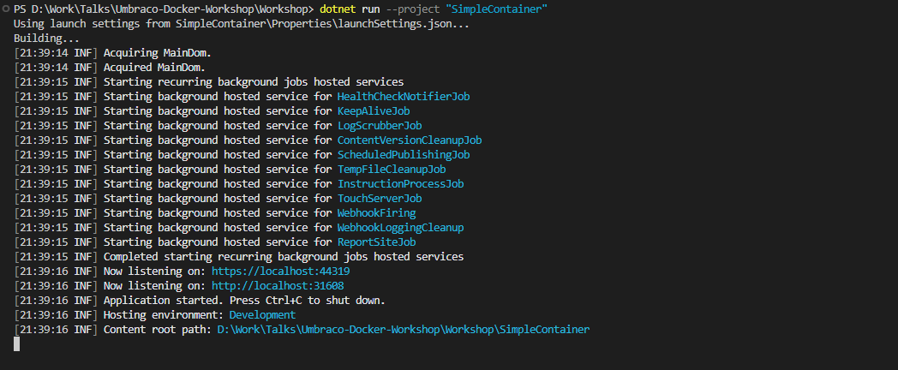
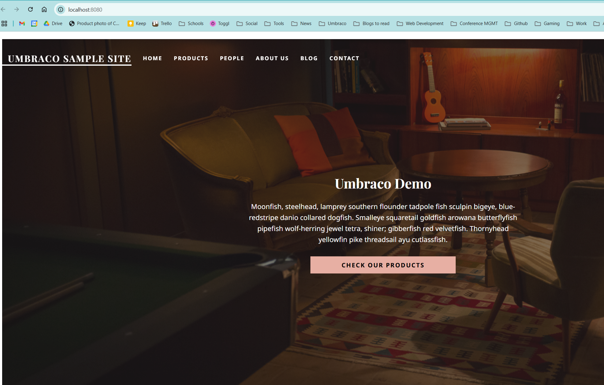

# Simple Umbraco Container

In this introduction exercise, we will create a simple Umbraco container that runs locally on your machine. It will be a completely standalone container, but will allow us to understand the basics of how to run Umbraco in a container, how to build a container image, and how to run it.

This exercise will cover the following steps:
1. Set up the Umbraco website using the .NET CLI.
2. Create a Dockerfile to build the Umbraco site into a Docker image.
3. Build the Docker image using the Docker CLI.
4. Run the Docker container locally to test the Umbraco site.

This exercise is designed to introduce you to the concepts and is not intended to be a production-ready solution, but is a good starting point for learning how to work with Umbraco in a containerized environment. It will use SQLite as the database, which is suitable for development and testing purposes.

## Set up the Umbraco Website

Firstly ensure you are in the **/Workshop** folder in your terminal window and run the following command to create a new Umbraco site. 

```bash
dotnet new install Umbraco.Templates::17.8.2 --force

dotnet new sln --name "SimpleContainer"
dotnet new umbraco --force -n "SimpleContainer" --release LTS -pm PerProject --friendly-name "Administrator" --email "admin@example.com" --password "1234567890" --development-database-type SQLite
dotnet sln SimpleContainer.slnx add "SimpleContainer"

dotnet add SimpleContainer package Umbraco.TheStarterKit --version 17.0.0
```

This will create a new Umbraco site in a folder called `SimpleContainer`, with the administrator user set up and the Starter Kit installed. It's using the SQLite database for simplicity.

A few notes on these commands:

- `--release LTS` creates the site using the current Long Term Support release of Umbraco (17).
- `-pm PerProject` keeps the NuGet package versions in the `.csproj` file. By default, the Umbraco 17 template uses Central Package Management, which stores versions in a separate `Directory.Packages.props` file. That would mean copying an extra file into the container before running `dotnet restore`, so we keep things simple.
- In .NET 10, `dotnet new sln` creates a solution file in the new XML-based **.slnx** format, which is why we add the project to `SimpleContainer.slnx`.

## Run the Umbraco Site Locally

Before we proceed with Docker, let's ensure that the Umbraco site runs correctly on your local machine. You can do this by running the following command in the terminal:

```bash
dotnet run --project "SimpleContainer"
```

Check the output of the terminal window to see which ports the site is running on. Umbraco will install itself into a new SQLite database, and then install the Starter Kit.



### Publish the Starter Kit content

The Starter Kit imports its content when the site first runs, but on a fresh install of Umbraco 17 that content is **not published**, so if you browse to the site straight away you will see a "Page Not Found" message.

***Action:*** Publish the Starter Kit content:

1. Browse to the Umbraco backoffice using the **https** URL shown in the terminal, followed by `/umbraco`, e.g. `https://localhost:44311/umbraco`. You must use the https address - Umbraco 17 won't let you log in over plain http by default.
2. Log in with the username `admin@example.com` and password `1234567890`.
3. In the **Content** section, open the actions menu (**...**) on the **Home** node and select **Publish with descendants**. Make sure the option to include unpublished content items is selected, then publish.

Now browse to the site and you should see the familiar Umbraco Sample Site. You will also notice that installing the Starter Kit has created the template views for the site in the `SimpleContainer/Views` folder.

Stop the site by pressing **Ctrl + c** in the terminal window.

## Create the Dockerfile

Next, we will create a `Dockerfile` in the `SimpleContainer` folder. This file will contain the instructions to build the Docker image for our Umbraco site.

Create a file called `Dockerfile` in the `SimpleContainer` folder and add the following content. The case of the file name is important, it must be `Dockerfile` with a capital "D". You also need to ensure that the line endings are set to Unix style (LF) if you are on Windows, as Docker requires this for the file to be read correctly.#

*Note: It's possible to get the Umbraco Template to generate you a dockerfile in later versions of Umbraco using the `--add-docker` option. We are going to write our own to understand how it works.*

```dockerfile
# Use the SDK image to build and publish the website
FROM mcr.microsoft.com/dotnet/sdk:10.0 AS build
WORKDIR /src
COPY ["SimpleContainer.csproj", "."]
RUN dotnet restore "SimpleContainer.csproj"
COPY . .
RUN dotnet publish "SimpleContainer.csproj" -c Release -o /app/publish

# Copy the published output to the final running image
FROM mcr.microsoft.com/dotnet/aspnet:10.0 AS final
WORKDIR /app
# Set the environment to Development, so that Umbraco loads the connection string from the appsettings.Development.json file
ENV ASPNETCORE_ENVIRONMENT=Development
# Set the port that Umbraco will listen on inside the container
ENV ASPNETCORE_HTTP_PORTS=8081
# The container serves plain HTTP, so allow backoffice logins without HTTPS
ENV Umbraco__CMS__Global__UseHttps=false
# Document the port that the application will run on
EXPOSE 8081

# Copy the published output to the final running image
COPY --from=build /app/publish .

# Set the entrypoint to the web application
ENTRYPOINT ["dotnet", "SimpleContainer.dll"]
```

Each line of the Dockerfile explained (with Docker cache notes):

- `FROM mcr.microsoft.com/dotnet/sdk:10.0 AS build`  
  Uses the official .NET 10 SDK image as the build environment. (Cached if the base image hasn't changed.)
- `WORKDIR /src`  
  Sets the working directory inside the build image to `/src`. (Cached unless the previous layer changes.)
- `COPY ["SimpleContainer.csproj", "."]`  
  Copies the project file into the container. (Cached unless the csproj file changes.)
- `RUN dotnet restore "SimpleContainer.csproj"`  
  Restores NuGet packages. (Cached unless the csproj or referenced packages change.)
- `COPY . .`  
  Copies the rest of the source code into the container. (Cached unless any source file changes.)
- `RUN dotnet publish "SimpleContainer.csproj" -c Release -o /app/publish`  
  Builds and publishes the app to `/app/publish`. (Cached unless code or dependencies change.)

- `FROM mcr.microsoft.com/dotnet/aspnet:10.0 AS final`  
  Uses the smaller ASP.NET runtime image for the final container. (Cached if the base image hasn't changed.)
- `WORKDIR /app`  
  Sets the working directory in the runtime image. (Cached unless previous layer changes.)
- `ENV ASPNETCORE_ENVIRONMENT=Development`  
  Sets the environment variable so Umbraco uses the development config. (Cached unless this line changes.)
- `ENV ASPNETCORE_HTTP_PORTS=8081`  
  Sets the app to listen for HTTP on port 8081. (Cached unless this line changes.)
- `ENV Umbraco__CMS__Global__UseHttps=false`  
  Umbraco settings can be set with environment variables, using double underscores in place of the `:` separators. Umbraco 17 only allows backoffice logins over HTTPS unless `UseHttps` is `false`, and this container only serves HTTP. (Cached unless this line changes.)
- `EXPOSE 8081`  
  Documents that the container will listen on port 8081. (Does not affect cache or runtime, just metadata.)
- `COPY --from=build /app/publish .`  
  Copies the published app from the build image. (Cached unless the published output changes.)
- `ENTRYPOINT ["dotnet", "SimpleContainer.dll"]`  
  Sets the default command to run the app. (Cached unless this line changes.)

**Docker cache notes:**
- Docker caches each instruction as a layer. If nothing relevant has changed, Docker reuses the cached layer, making builds faster.
- COPY and RUN instructions are only cached if the files they depend on haven't changed.
- Changing a file or instruction invalidates the cache for that and all following layers.

This breakdown helps you understand both what each line does and how Docker optimizes builds using its cache.

## Create a .dockerignore file

The `COPY . .` line copies everything in the project folder into the build image, including the `bin` and `obj` folders from your local builds, and the local SQLite database. These aren't needed, slow down the build, and the `obj` folder contains paths from your machine which can confuse the build inside the container.

***Action:*** Create a file called `.dockerignore` in the `SimpleContainer` folder with the following content:

```
bin/
obj/
umbraco/Data/
umbraco/Logs/
```

Any files or folders matching these patterns are excluded when Docker sends the project to the build.

## Build the Docker Image
Now that we have the Dockerfile set up, we can build the Docker image. Make sure you are in the `Workshop` folder and run the following command. The latest tag is optional, but it's good practice to use it for clarity. Here we are tagging the image with both `1.0.1` and `latest` versions:

```bash
docker build -t simplecontainer:1.0.1 -t simplecontainer:latest ./SimpleContainer
```

This command will build the Docker image using the Dockerfile in the `SimpleContainer` folder and tag it as `simplecontainer`. The build process will take a few moments as it downloads the necessary base images and builds the Umbraco site.

## Run the Docker Container

Once the image is built, you can run the Docker container using the following command:

```bash
docker run -d -p 8080:8081 --name simplecontainer simplecontainer:latest
```

It will take a few moments for the container to start up and for Umbraco to initialize.

The container has its own brand new SQLite database, so just like when you ran the site locally, the Starter Kit content needs to be published.

***Action:*** Browse to `http://localhost:8080/umbraco`, log in with `admin@example.com` / `1234567890`, and publish the **Home** node with its descendants as you did before.

You should then be able to access the Umbraco site by navigating to `http://localhost:8080` in your web browser.



## Build a new version of the Umbraco site image

Next we will make a change to the site, and build a new version of the image to see that change running in a container.

***Action:*** Open `SimpleContainer/Views/Home.cshtml` and find the following line:

```html
<h1>@Model.HeroHeader</h1>
```

Change it to the following:

```html
<h1>@Model.HeroHeader - running in Docker!</h1>
```

Now we need to rebuild the Docker image to see the changes. Run the following command in the terminal:

```bash
docker build --no-cache -t simplecontainer:1.0.2 -t simplecontainer:latest ./SimpleContainer
```

This will rebuild the Docker image with the updated content. This build command uses the `--no-cache` option to ensure that all layers are rebuilt, including the one that contains your modified view, and will take a bit longer than the previous build since it will not use any cached layers.

After the build is complete, you need to stop and remove the existing container before running the new one:

```bash
docker stop simplecontainer
docker rm simplecontainer
```
Now, run the new container with the updated image:

```bash
docker run -d -p 8080:8081 --name simplecontainer simplecontainer:latest
```

As this is a new container, it has a new empty database. Log in to `http://localhost:8080/umbraco` and publish the **Home** node with its descendants again, then browse to `http://localhost:8080` to see your updated heading.


### Run a New Instance on a Different Port

You can start another instance of the container on a different port by changing the left side of the port mapping. For example, to run on port 8082:

```bash
docker run -d -p 8082:8081 --name simplecontainer2 simplecontainer:latest
```

Now, you can access the new instance at `http://localhost:8082`. 

**Note: Because this container manages its own data, it will not share any content or media with the first container.** You will need to log in to `http://localhost:8082/umbraco` and publish the Home node in this instance too.

### Stop and Remove the Running Container

To stop the new running container, use:

```bash
docker stop simplecontainer2
```

To remove the stopped container (optional):

```bash
docker rm simplecontainer2
```

One thing to note is that these two containers are completely independent of each other. They do not share any data, media or files, and any changes made in one container will not affect the other. The only thing they have in common is the Docker image they were created from, which is `simplecontainer`. This is a key feature of containerization, as it allows you to run multiple instances of the same application without them interfering with each other.

## Summary

Congratulations! You've successfully created a simple contianer, built it's image and run the website from that image which should hopefully give you a taster of how Umbraco can be run in a containerized environment.

**Key things we did in this exercise:**

- Created a new Umbraco site using the .NET CLI and installed the Starter Kit.
- Configured the site to run on a specific port for containerization.
- Wrote a Dockerfile to build and run the Umbraco site in a container.
- Built a Docker image for the Umbraco site.
- Ran the Umbraco site in a Docker container and accessed it via the browser.
- Started additional container instances on different ports.
- Stopped and removed containers as needed.

### Next Step

Now that we have a simple Umbraco container running, the next step is to set up a database container that our Umbraco site can connect to. This will allow us to store content and media in a more robust way than using SQLite. Open [3. Database Container](3-Database-Container.md) to continue.