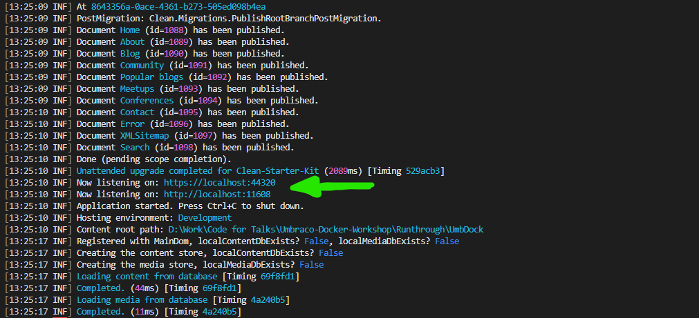

# Exercise 4. Creating the basic Umbraco Editor Site Container

We are going to create our Umbraco website running locally on your machine natively, and connected to the database container we just created.

## 4.1 Installing Umbraco Template and start Website

***Action:*** Create a new Umbraco site using the following command. This will define the name of the site and the default database, as well as the default admin user and password. 

```bash
dotnet new umbraco -n UmbWeb --release LTS -pm PerProject --friendly-name "Admin User" --email "admin@admin.com" --password "1234567890" --connection-string "Server=localhost;Database=UmbracoDb;User Id=sa;Password=SQL_PassW0rd@1234;TrustServerCertificate=true"
```

### Create the SLN file and Starter Kit

Run the following command to create the solution file for the Umbraco site. Run the following command in the **/Workshop** folder. This will create a new solution file and add the Umbraco project starter kit template.

```bash
# Create a new solution file for the Umbraco site
dotnet new sln --name "Umbraco-Docker-Workshop"
dotnet sln Umbraco-Docker-Workshop.slnx add "UmbWeb/UmbWeb.csproj"

# Add the Umbraco StarterKit package to the project
dotnet add UmbWeb package Umbraco.TheStarterKit --version 17.0.0
```

## 4.2 Start the Umbraco Website

***Action:*** Run the website by issuing the following command. This will start the website using Kestrel, and connect to the database server in the container.

```bash
dotnet run --project UmbWeb
```

This should, if there are no errors, start up the website for you to browse.



The terminal will show the URLs the site is listening on - the port numbers are randomly chosen when the project is created, so they will be different on your computer. Use the **https** URL, e.g. `https://localhost:44311`, as Umbraco 17 won't let you log in to the backoffice over plain http by default.

### Publish the Starter Kit content

As in the first exercise, the Starter Kit content is imported but not published on a fresh install, so the site will show "Page Not Found" until you publish it. This time the content is stored in the SQL Server database in the container, on the `umbSqlFiles` volume, so you only need to do this once - all the website containers we create later will use this same database.

***Action:*** Browse to the Umbraco backoffice at your https URL followed by `/umbraco`, e.g. `https://localhost:44311/umbraco`, and log in using the credentials below.

- Username : admin@admin.com
- Password : 1234567890

In the **Content** section, open the actions menu (**...**) on the **Home** node and select **Publish with descendants**, making sure the option to include unpublished content items is selected, then publish. Browse to the site and you should see it running.

This will illustrate that developing with Umbraco in a container is very similar to developing with Umbraco natively, and that you can run the site locally on your machine without needing to use Docker. Once we have the site setup and running, we will then look at how to containerize the site and run it in a Docker container.

## Next Steps

Let's put that website in a container - open [5. Website Container](5-Website-Container.md) to do this.

