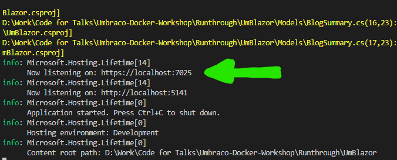
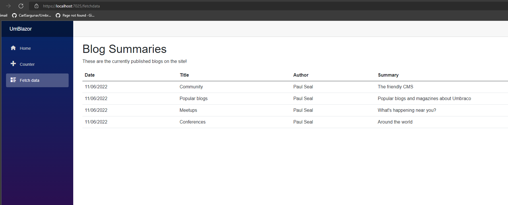

# 7 Add the Blazor Container

We will now create a final container which will be used to run a Blazor app, connect to the Content Delivery API and show a list of the products from the Starter Kit.

## 7.1 Create the Blazor App and show the products

***Action:*** Start a new Blazor WASM project by running the following:

```bash
dotnet new blazorwasm --name UmBlazor --framework net10.0

## Add the project to the solution file
dotnet sln Umbraco-Docker-Workshop.slnx add "UmBlazor/UmBlazor.csproj"
```

***Action:*** Copy the following from the /Files/UmBlazor folder to the /Workshop/UmBlazor folder, replacing any existing files.

- **/Files/UmBlazor/Program.cs** to **/Workshop/UmBlazor/Program.cs** - this registers the service which calls the Umbraco API
- Everything from **/Files/UmBlazor/Models** to **/Workshop/UmBlazor/Models**
- Everything from **/Files/UmBlazor/Services** to **/Workshop/UmBlazor/Services**
- **/Files/UmBlazor/Pages/FetchData.razor** to **/Workshop/UmBlazor/Pages/FetchData.razor**
- **/Files/UmBlazor/Layout/NavMenu.razor** to **/Workshop/UmBlazor/Layout/NavMenu.razor**
- **/Files/UmBlazor/wwwroot/appsettings.json** to **/Workshop/UmBlazor/wwwroot/appsettings.json**
- **/Files/UmBlazor/wwwroot/appsettings.Staging.json** to **/Workshop/UmBlazor/wwwroot/appsettings.Staging.json**

***Action:*** Test that the application works by running the following command in your terminal:

```bash
    dotnet run --project UmBlazor
```
    
Ignoring any warnings, you should be able to browse the WASM site using the relevant output URL



In my case I can use https://localhost:7025. This will bring up a site, and the **Fetch Umbraco Data** page should show the products from the Umbraco site running in the **umbweb** container on port 8000.

Stop the app by pressing **Ctrl + c** in the terminal window.




## 7.2 Create the Blazor Container

To run the Blazor WASM app in a container, it's a little different to running an Umbraco website. The Umbraco site needs to run Kestrel as a webserver, but Blazor WASM just needs to serve files. As such it will use nginx to serve these pages on the container, as it's a lightweight web server which runs really well with containers.

I've created the Dockerfile and nginx configuration file, these need to be copied to the project folder.

***Action:*** Copy the following:

- **/Files/UmBlazor/Dockerfile** to **/Workshop/UmBlazor/Dockerfile**
- **/Files/UmBlazor/nginx.conf** to **/Workshop/UmBlazor/nginx.conf**
- **/Files/UmBlazor/.dockerignore** to **/Workshop/UmBlazor/.dockerignore**

*Note : Don't copy the other files yet*

Looking at the contents of the Dockerfile : 

```dockerfile
FROM mcr.microsoft.com/dotnet/sdk:10.0 AS build
WORKDIR /src
COPY UmBlazor.csproj .
RUN dotnet restore UmBlazor.csproj
COPY . .
RUN dotnet build UmBlazor.csproj -c Release -o /app/build

FROM build AS publish
# Blazor WebAssembly runs in the browser, so its environment (which decides which
# appsettings.{Environment}.json file is loaded) is baked in when the app is published.
ARG BLAZOR_ENVIRONMENT=Production
RUN dotnet publish UmBlazor.csproj -c Release -o /app/publish -p:WasmApplicationEnvironmentName=$BLAZOR_ENVIRONMENT

FROM nginx:alpine AS final
WORKDIR /usr/share/nginx/html
COPY --from=publish /app/publish/wwwroot .
COPY nginx.conf /etc/nginx/nginx.conf
```

We can see that this container is using the nginx image, and rather than starting the application, it merely hosts the published output of the UmBlazor project.

Because a Blazor WebAssembly app runs in the browser and not on the server, we can't choose its environment with an environment variable when the container starts, as we did with the Umbraco containers. Instead, the environment is set when the app is published, using the `BLAZOR_ENVIRONMENT` build argument. This controls which **appsettings.{Environment}.json** file the app loads, and therefore which Umbraco URL it calls.

### Build Image and run the container

Next we can build the Blazor Image using the following command. We pass in `Staging` as the environment, so the app uses **appsettings.Staging.json** and calls the umbweb container on port 8000.

***Action:*** Run the following command to build the image.

```bash
docker build -t umblazor:1.0.0 -t umblazor:latest --build-arg BLAZOR_ENVIRONMENT=Staging ./UmBlazor
```

Once that's done, we can run the Container

***Action:*** Run the following command to start the container.

```bash
docker run --name umblazor -p 8002:80 --network=umbNet -d umblazor:latest
```

Now the site could be browsed using the containter using the url [http://localhost:8002/](http://localhost:8002/).
   
Upon running the site we should see the same Blazor app from the earlier example, but this time running from the container instance, and when it queries the REST API to load the products, it is doing so from the umbweb container.

## Next Steps

We're going tie it all together with a Docker Compose file, which will let us orchestrate, start and stop our multi-continer application - [8. Docker Compose](8-Docker-Compose.md).
