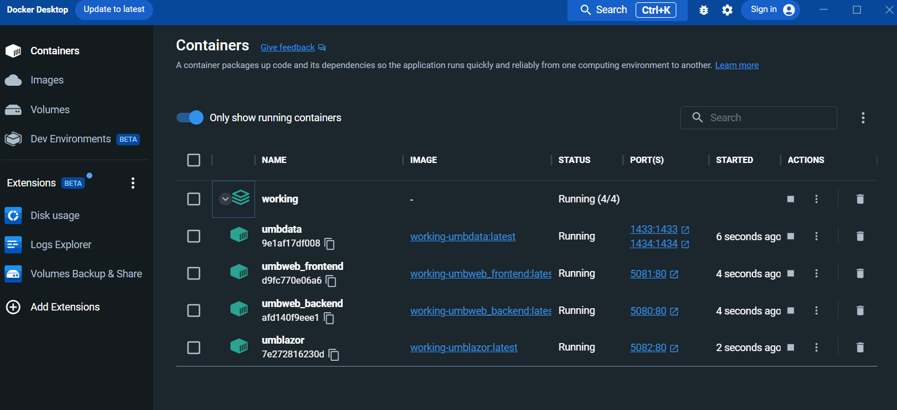

# 8 Docker compose

So far we have created all our containers manually which is fine, but we want to make this repeatable. In this part we will use Docker compose to deploy all containers together, and to configure the network between them. This will use the Production profiles of the various projects.

Docker compose is a tool for defining and running multi-contianer applications including :

- Names of each of the containers (called Services in Docker compose)
- The networks each container connects to
- The volumes used by each container
- The ports exposed by each container
- Environmental variables configured for each container

This single file represents the entire application, and can be used to deploy the application to any environment.

## 8.1 Create the Docker Compose file

I've prepared a single docker compose file to complete this application To prepare the application for deployment with Docker compose:

***Action:*** Copy the following files:

- Copy **/Files/docker-compose.yml** to **/Workshop/docker-compose.yml**
- Copy **/Files/UmbWeb/appsettings.Production.json** to **/Workshop/UmbWeb/appsettings.Production.json**
- Copy **/Files/UmBlazor/wwwroot/appsettings.Production.json** to **/Workshop/UmBlazor/wwwroot/appsettings.Production.json**

These will configure the application to use the production profiles, and will also configure the connection strings for the databases, which will be used when we run the application as single distributed application.

Note that in the Production profile the database server is called **app_umbdata**, as that's the name of the database container in the Docker Compose file. The Docker Compose file also uses the same named volumes you created in the earlier exercises (`umbSqlFiles`, `umb_media` and `umb_logs`), so the application will use the same database and media - including the content you published.

## 8.2 Run the Docker Compose file

Before we run the application, we need to stop and remove all the containers we created manually, so that any ports and volumes they are using are freed up. This is important as the database container created by Docker Compose will use the same port (1433) and the same database volume.

**Action :** Run the following commands in your terminal:

```bash
docker stop umblazor umbweb umbweb2 umbdata
docker rm umblazor umbweb umbweb2 umbdata
```

Verify that none are running by looking at the Docker Desktop app, or by running the `docker ps` command. Once all the containers have been removed, we can run the Docker Compose file.


**Action :** Start all containers using the following command:

```bash
docker compose up -d
```

This will first build the images and then start all the containers, and if you open Docker Desktop, you should see all the containers running.



Once these are up, we can browse the umbraco websites using the following URLs

- Umbraco 1 : http://localhost:5080/ 
- Umbraco 2 : http://localhost:5081/
- Blazor : http://localhost:5082/

It may take a minute for the Umbraco sites to start, and for the Delivery API index to be built before the Blazor app shows any products.

To stop and remove the containers, run the following command:

```bash
docker compose down
```

This removes the containers and the network, but leaves the volumes - and therefore your database and media - in place.

## Next Steps 

Now we've gone through the exercise, let's draw our conclusions [9. Conclusion](9-Conclusion.md). There's also a guide for the Docker CLI [10. Docker CLI Quick Start](10-Docker-CLI-Quick-Start.md).